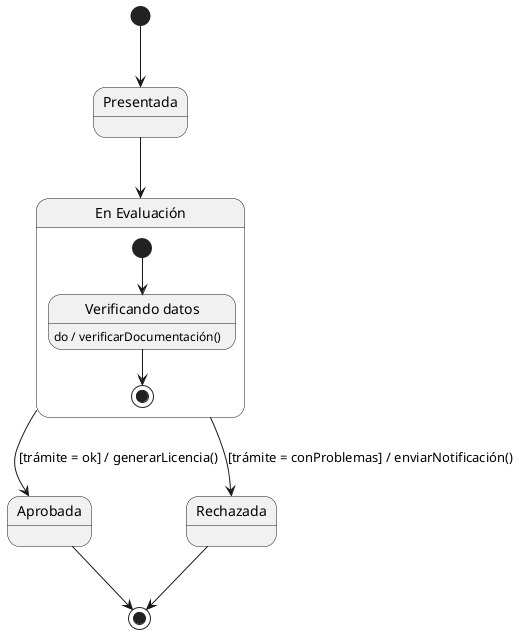

# Skill: Máquina de Estados - Pautas de Cátedra (DSI 2026)

- **Fuente de verdad:** [apunte.md](../../../apunte.md) → sección *Máquina de estados* (incluye el ejemplo resuelto de la licencia de conducir).
- **Qué modela:** el **ciclo de vida de un único objeto de una clase**: en qué situaciones puede estar, qué eventos lo hacen cambiar y qué hace al cambiar.

## Notación

| Elemento | Notación | Ejemplo |
| :--- | :--- | :--- |
| Estado | Rectángulo de esquinas redondeadas | `Confirmado`, `Verificando datos` |
| Evento | Primer término sobre la flecha | `confirmar()`, `after(48 h)` |
| Transición | Flecha continua | `Reservado → Confirmado` |
| Guarda | `[ ... ]` | `[cupo > 0]` |
| Acción | `/ acción` | `/ liberarHorario()` |
| Estado inicial | Círculo relleno ● (**uno solo** por diagrama y uno por estado compuesto) | `[*]` |
| Estado final | Círculo con borde ◉ (puede haber varios; lo recomendable es uno) | `[*]` |

## Procedimiento de resolución

1. **Objeto y tipo de ciclo:** subrayar en el enunciado el sustantivo cuyo estado cambia (*Turno*, *Pedido*, *Trámite*) y los verbos que le ocurren.
   - **Finito** (Pedido, Turno, Inscripción, Ejemplar dado de baja…): va de ● a ◉ cuando el ciclo concluye.
   - **Continuo o reactivo** (Teléfono, Ascensor, Cajero): vuelve a un estado de reposo sin ◉, salvo una destrucción.
2. **Estados:** salen de los **adjetivos y participios** del enunciado ("pendiente", "confirmado", "cancelado").
   - Si el objeto puede **quedarse ahí esperando algo** → es un estado. Si no, es un evento o una acción.
   - Nombres: adjetivo o participio (`Confirmado`, `Pendiente`) o, si está haciendo algo, `Verificando datos`. **Nunca infinitivo** (`Confirmar` ✗).
3. **Transiciones:** por cada estado, preguntarse qué puede ocurrirle y adónde va. Armar la tabla *Origen / Evento [guarda] / acción / Destino* antes de dibujar.
4. **Estados compuestos:** si dos o más estados comparten la **misma transición de salida** (mismo evento, mismo destino), agruparlos en un estado compuesto y sacar **una sola flecha desde su borde**. Cada compuesto tiene su propio estado inicial.

## Coherencia con el resto del parcial

- Cada **evento de llamada** es una operación de la clase: figura en su **diagrama de clases** y en su **tarjeta CRC**.
- Cada **acción** es un método propio o un mensaje a otro objeto.
- La clase necesita un **atributo `estado`**. Si piden el **patrón State**, cada estado del diagrama pasa a ser una clase `EstadoConcreto` (ver [dsi-patrones-diseno](../dsi-patrones-diseno/SKILL.md)).
- **Precondición/postcondición del CU = estado del objeto antes y después:** si el CU "Confirmar Turno" deja el turno confirmado, tiene que existir `Reservado → Confirmado` con `confirmar()`.

## PlantUML

## Checklist

- [ ] Un solo estado inicial; finales según el tipo de ciclo.
- [ ] Estados con adjetivo/participio o gerundio, nunca infinitivo.
- [ ] Cada estado tiene al menos una salida (salvo los finales).
- [ ] Estados con misma salida agrupados en compuesto.
- [ ] Eventos y acciones existen como métodos en clases y CRC; la clase tiene atributo `estado`.
