# Apunte Parcial Práctico 2026

A partir del 2026 solamente se rinde el parcial práctico del segundo cuatrimestre. A continuación se detallan los temas y su manera de encararlos a la hora de la resolución.

**Hecho por:**
* Mateo Lopez
* Agustin Carrasco
* Lautaro Sandoval

---

## Pasos para resolver

1. Primero se hace el [diagrama de casos de uso](#diagrama-de-casos-de-uso) de **todos** los casos de uso del escenario.
2. Se hace la [descripción de caso de uso](#descripción-de-caso-de-uso) indicado (ej: CU1).
3. Se hace la [realización del CU](#realización-del-caso-de-uso) con los siguientes elementos:
   1. [Diagrama de clases](#1---diagrama-de-clases) (de las clases involucradas en el caso de uso).
      1. Al principio no se ponen los métodos ni los atributos: se agregan después de hacer el diagrama de secuencia.
      2. Al terminar el diagrama de secuencia, en base a los métodos que se idearon y usaron ahí, por cada clase se arma un cuadradito con su nombre y se escriben sus métodos. Lo mismo con los atributos.
   2. [Diagrama de secuencia](#2---diagrama-de-secuencia) de ese caso de uso.
   3. [Tarjetas CRC](#3---tarjeta-crc) (de las clases utilizadas en el diagrama de clases de ese caso de uso CU1).
      1. Este se deja para lo último: ya hecho el diagrama de clases con los métodos que se usaron en el diagrama de secuencia, sale enseguida.
4. [Máquina de estados](#máquina-de-estados).
5. [Patrones de diseño](#patrones-de-diseño).

**Extra:**
* [Diagrama de clases en Java](#diagrama-de-clases-en-java).

---

## Diagrama de Casos de Uso

```text
                    Sistema
              +-----------------+
   Actor 1 ---|----( CU1 )      |
          \---|----( CU2 )------|------> (Entidad)
              |                 |
   Actor 2 ---|----( CU3 )------|------- Actor externo
          \---|----( CU4 )      |
              +-----------------+
```

Es un mapa visual que delimita los límites del sistema, quién interactúa con él (**Actores**) y qué funcionalidades de valor ofrece (**Casos de Uso**), sin entrar en el orden cronológico de las acciones.

### Elementos clave

* **Actores:**
  * Son los que inician el caso de uso (actores del lado izquierdo).
  * Representan un rol externo al sistema, jamás un nombre propio (ej: *Cajero*, *Cliente*, *Administrador*; no *Juan Pérez*).
  * Pueden ser sistemas externos que envían o reciben datos (ej: *AFIP*).
  * Los actores del lado derecho suelen ser externos al sistema y actúan como soporte o receptores de información sin iniciar el caso de uso.
* **Casos de Uso (Óvalos):**
  * Nombre: `[Verbo en infinitivo] + [Sustantivo]` (ej: *Registrar Pedido*).
* **Asociación (Línea sólida simple):**
  * Conecta al actor con el óvalo del caso de uso en el que participa.
  * **No lleva flechas.**
* **Límite del Sistema (System Boundary):**
  * Un rectángulo grande con el nombre del sistema arriba.
  * **Regla de oro:** Los casos de uso van adentro; los actores van siempre afuera.
  * La profe en clase por ahí lo saltea; hay que preguntar si lo usamos o no en el parcial. No creo que esté de más.

### Relaciones

| Relación | Cuándo se usa | Sentido de la flecha |
| :--- | :--- | :--- |
| `<<include>>` | Parte obligatoria o común que se extrae para reutilizar. Es por si el CU base **no puede completarse** sin este. | Línea punteada que apunta **hacia el caso de uso incluido** (`CU Base → CU Incluido`). |
| `<<extend>>` | Comportamiento opcional o condicional que ocurre bajo cierta regla/evento. | Línea punteada que apunta **hacia el caso de uso base** (`CU Extensión → CU Base`). |
| **Generalización (Herencia)** | Un actor o caso de uso hereda el comportamiento de otro más general (ej: *Usuario Registrado* hereda de *Usuario*). | Línea sólida con flecha triangular hueca hacia el padre (`——▷`). |

### Errores típicos

* **Casos de uso "huérfanos":** Dejar un óvalo sin conectar a ningún actor.
* **Conectar actores entre sí con líneas simples:** Entre actores **solo** puede haber relación de generalización/herencia (flecha con punta hueca).
* **Descomposición funcional:** Crear casos de uso para pasos individuales dentro de un proceso más grande (ej: crear *Validar Contraseña* o *Buscar Producto* como casos de uso aislados en lugar de integrarlos dentro del flujo de *Iniciar Sesión* o *Registrar Venta*).
* **Invertir las flechas de include y extend:** El base **necesita/incluye** al otro. La extensión **le agrega algo** a la base. Por lo tanto, la flecha apunta al que se agrega.

---


---

## Descripción de Caso de Uso

En la **descripción textual** (o plantilla de caso de uso) se explica paso a paso la interacción entre el **actor** y el **sistema**.

1. **Actor:** El rol que inicia la acción (ej: *Cajero*).
2. **Precondición:** Qué debe ser verdad en el sistema antes de empezar (ej: *El usuario debe estar autenticado en el sistema*).
   1. Lo que se especifica en la precondición no se vuelve a indicar en el camino.
   2. La precondición es independiente de si la acción ocurre en el camino estándar o en uno alternativo: si algo ya está garantizado por la precondición, tampoco se repite en los caminos alternativos.
   3. Ej: Precondición: *Alumno autenticado*. No pongas:
      1. Alumno ingresa usuario y contraseña.
      2. El sistema valida usuario y contraseña.

      La autenticación ya ocurrió antes; por ende, el paso 1 también.
3. **Postcondición:** Estado en el que queda el sistema tras completar el objetivo (ej: *La venta queda registrada y el stock actualizado*).
   1. **OJO:** Precondición y Postcondición siempre se refieren al **sistema**, nunca a algo del usuario.
   2. La postcondición **sólo se escribe si la ejecución produce un cambio de estado interno** en el sistema (ej: se registra una venta, se actualiza el stock). Si el caso de uso solo consulta o muestra información y no modifica nada, **no lleva postcondición**.
4. **Camino Estándar:** Los pasos alternan entre **acción del actor** y **respuesta del sistema**.
   1. La idea es que sea uno y uno: actor, sistema, actor, y así sucesivamente.
   2. **Ingreso múltiple:** el actor **no puede ingresar listas o estructuras de datos al sistema de una sola vez**. La selección múltiple se modela de forma iterativa: el sistema muestra las opciones, el actor selecciona y envía **un** elemento, el sistema responde, y el ciclo se repite hasta que el actor indica que terminó.
   3. Ej: *3. El sistema muestra las materias disponibles. 4. El actor selecciona una materia. 5. El sistema registra la materia y vuelve a mostrar las disponibles (se repiten los pasos 4 y 5 hasta que el actor confirma la inscripción).*
   4. Usa lenguaje generalista: habla de *"ingresar datos"*, *"validar"*, *"solicitar confirmación"*.
   5. **Nunca detalles técnicos ni de interfaz gráfica** (prohibido poner *"el usuario presiona el botón X"* o *"se ejecuta un INSERT en la tabla Y"*; se pone *"el actor confirma la operación"* o *"el sistema registra la venta"*).
5. **Caminos Alternativos:** Los desvíos del camino feliz donde algo falla o se toma otra opción válida (ej: datos incorrectos, falta de stock, cancelación).
   1. Todo camino alternativo debe indicar explícitamente:
      1. Si **vuelve** al flujo estándar (ej: *Retoma en el paso 3*).
      2. Si **termina** el caso de uso sin éxito (ej: *Fin del caso de uso*).
   2. **Numeración de caminos alternativos:** Supongamos que el desvío pasa en el paso 4; la numeración según el apunte de la cátedra es así:

      ```text
      4.a No hay evaluaciones pendientes
          1. El sistema informa que no encuentra evaluaciones pendientes para el alumno.
          2. Finalizar caso de uso / ir a paso X.
      ```

### Include en el CU

*(Sección pendiente de completar en el apunte original.)*

### Errores comunes a evitar

* **Olvidar al Actor:** Todo caso de uso debe estar iniciado directa o indirectamente por un actor (humano, rol o sistema externo).
* **Mezclar diseño técnico con requerimientos:** Hablar de pantallas, botones, tecnologías o bases de datos en la descripción del caso de uso.
* **Repetir la precondición** en el camino estándar o en los alternativos.
* **Ingresar listas de una sola vez:** el actor selecciona un elemento por vuelta.
* **Postcondición en un CU de solo consulta.**

---

## Realización del Caso de Uso

Se trabaja siempre sobre el caso de uso que fue seleccionado para su análisis y resolución.

### 1 - Diagrama de clases

En el diagrama de clases para una realización de caso de uso, el objetivo es representar exclusivamente las clases necesarias para ejecutar ese flujo específico:

* **Clases involucradas:** Incluye sólo aquellas clases que colaboran para cumplir los pasos del Caso de Uso, incluyendo obligatoriamente la clase **Controlador** (orquestador del flujo) y la clase de **UI** (interfaz de usuario), junto con las clases de dominio necesarias (nombre, atributos necesarios, métodos).
* **Relaciones:** Define asociaciones, agregación/composición y herencia (generalización) entre las clases.

| Relación | Símbolo en el gráfico | Cuándo usarla |
| :--- | :---: | :--- |
| **Herencia (Generalización)** | `——▷` (línea sólida, triángulo hueco) | Relación *"es un"* (Docente es una Persona). Hereda atributos y métodos. **No lleva multiplicidad en los extremos.** |
| **Composición** | `——◆` (línea sólida, rombo relleno en el extremo del **"Todo"**) | El ciclo de vida de las partes depende del todo. Rombo relleno (negro) en el extremo del "Todo" (el contenedor o dueño).<br>**Fórmula de lectura:**<br>- Desde el Todo hacia las Partes: *"Está compuesto por..."* o *"Posee exclusivamente como parte a..."*.<br>- Desde la Parte hacia el Todo: *"Forma parte de / pertenece a..."*. |
| **Agregación** | `——◇` (línea sólida, rombo hueco en el extremo del **"Contenedor"**) | Ciclo de vida independiente. Los elementos contenidos pueden existir por fuera del contenedor. Si el contenedor se elimina o resetea, los elementos contenidos siguen existiendo en el sistema.<br>**Fórmula de lectura:** *"Agrupa a..."*, *"Contiene a..."* o *"Está conformado por..."*. |
| **Asociación simple** | `——` (línea sólida) | Relación estructural estándar entre dos entidades independientes. |
| **Dependencia** | `- - >` (línea punteada, flecha abierta) | Cuando un elemento depende de otro para su funcionamiento (ej: una clase usa a otra como parámetro). |
| **Realización** | `- - ▷` (línea punteada, triángulo hueco) | Cuando una clase implementa una interfaz. |

* **Multiplicidad:** Indica cuántos objetos participan en la relación (ej: `1`, `*`, `0..1`).

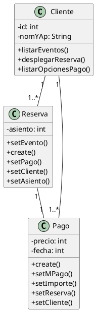

La multiplicidad de una clase **se lee mirando el extremo opuesto**. En este diagrama por ejemplo:
  * *Cliente* tiene de 1 a muchas *Reservas*, y *Reserva* pertenece a un solo *Cliente*.
  * *Cliente* tiene 1 o varios *Pagos*, y el *Pago* pertenece a un solo *Cliente*.

* **Visibilidad:** La visibilidad de una característica especifica si puede ser utilizada por otros clasificadores. En UML se pueden especificar cuatro niveles de visibilidad:

| Nivel | Símbolo | Definición |
| :--- | :---: | :--- |
| **public** | `+` | Cualquier clasificador externo con visibilidad hacia el clasificador dado puede utilizar la característica. |
| **protected** | `#` | Cualquier descendiente del clasificador puede utilizar la característica. |
| **private** | `-` | Sólo el propio clasificador puede utilizar la característica. |
| **package** | `~` | Sólo los clasificadores declarados en el mismo paquete pueden utilizar la característica. |

* **Alcance de instancia y estático** (no hace falta en práctica).
* **Clase DTO** (esto no se toma en práctica).

#### Clases UI, Controlador y Sistema

> Las clases **UI** y **Controlador** **no llevan atributos**.

* **UI:** Componente responsable de la interacción con el usuario, sin involucrarse en las reglas del negocio. Lo que hace (**métodos**):
  * Recibir datos del actor.
  * Mostrar información.
    * Mostrar confirmaciones o errores.
  * Pedir datos o selecciones.

  Estas clases no tienen nada que ver con las reglas de negocio.
* **CTRL:** Coordina la ejecución de un CU. Conceptualmente esta clase organiza la UI, el Sistema y las **clases del dominio** que tienen los datos (o sea, las clases comunes que ya venimos viendo en los diagramas de clases). Lo que hace (**métodos**):
  1. Iniciar una acción del CU.
  2. Recibe acciones de la UI.
  3. Coordinar el flujo de acciones para realizar el CU.
  4. Enviar mensajes al Sistema.
  5. Recibe resultados y continúa el flujo.
  6. **Delega a la UI lo que hay que mostrar o pedir:** estos mensajes pueden llevar estructuras de datos como parámetros (ej: `mostrarPrioridades(listaPrioridades)` para que la UI muestre la lista).
* **Sistema:** Representa la clase que tiene una visión general de la información manejada por la aplicación. Conoce los conjuntos de objetos principales y realiza operaciones que necesitan acceder o afectar a esa información global. Lo que hace (**métodos**):
  1. Mantiene/conoce los objetos que administra el sistema.
  2. Busca objetos dentro de esos conjuntos.
  3. Devuelve listas de objetos cuando se necesitan.
  4. Realiza las altas de nuevos objetos cuando corresponde.
  5. Cálculos generales que involucran información del sistema.
* **Dominio:** Representan conceptos, entidades o cosas que existen en el negocio. Son sobre los cuales el sistema realiza las operaciones. Saben hacer cosas en base a su propia información (ej: *Cliente*, *Producto*, *Materia*). A diferencia de la UI y el Controlador, las clases del dominio tienen:
  * **Atributos:** Información que define al objeto.
  * **Métodos:** Acciones que puede hacer o conocer el objeto.

#### Preguntas para hacerte con cada acción del enunciado

1. ¿Es una interacción con el actor? → **UI**
2. ¿Es coordinación del flujo del CU? → **CTRL**
3. ¿Necesita acceder al conjunto general, buscar, dar de alta o calcular globalmente? → **SISTEMA**
4. ¿Es información o comportamiento propio de un objeto concreto? → **Clase de dominio**
5. ¿Ese mensaje aparece llegando a la clase en el diagrama de secuencia? → **Tiene que estar como método en esa clase.**

#### Consejos clave

* **Alcance:** No incluir clases del sistema que no intervienen en el flujo del CU.
* **Foco en el comportamiento:** Asegurar que los métodos invocados durante el flujo estén descritos, ya que van a ser usados en el diagrama de secuencia.
* **Coherencia:** Si una clase aparece en el diagrama, debe tener su tarjeta CRC.
* **No uses nombres en plural para las clases:** no pongas *Pacientes*, escribí *Paciente*.

---

### 2 - Diagrama de secuencia

Es un modelo dinámico que representa el intercambio de mensajes entre objetos ordenado estrictamente por secuencia temporal (eje vertical). Muestra el sistema en tiempo de ejecución, evidenciando cómo las instancias colaboran para concretar el flujo exacto del Caso de Uso.

#### Orden visual (de izquierda a derecha)

Para mantener un estándar al resolver el parcial, es bueno siempre poder ubicar los elementos en este orden:

1. **Actor:** Quien inicia el flujo.
2. **Pantalla (`<<Boundary>>` o UI):** Interfaz del actor. Recibe y muestra, sin lógica. Nombre: `UI[Nombre del CU]` (ej: `UIRealizarReserva`).
3. **Controlador de CU (`CTRLCU`):** El orquestador específico del caso de uso. Nombre: `CTRL[Nombre del CU]` (ej: `CTRLRealizarReserva`).
4. **Controlador de Sesión (`CTRLSesion`):** Objeto preexistente que maneja el contexto y seguridad.
5. **Sistema (`<<Sistema>>`):** Fachada centralizadora de colecciones globales y operaciones.
6. **Colecciones y Entidades (`<<Entity>>`):** Clases del dominio.
7. **Actor Externo:** Servicios de terceros (ej: pasarelas de pago). Siempre en el extremo derecho.

> **IMPORTANTE:** Todos los mensajes que llegan a una clase los tienen que tener definido como métodos de esa clase en el diagrama de clases.

```text
  Actor   [UI[CU]]   [CTRL[CU]]   [CTRLSesion]   [Sistema]   [Entidad]   Actor Externo
   웃                                                                         웃
```

#### Ciclo de vida y ejecución

1. **Línea de vida (Lifeline):** Línea vertical punteada descendente que indica la existencia del objeto.
2. **Foco de Control (Caja de Activación):** Rectángulo vertical sobre la línea de vida. Representa el lapso exacto donde el objeto tiene el control del procesamiento.
3. **Destrucción Explícita (X o `destroy`):** Marcador al final de la línea que indica eliminación definitiva.

```text
   [ :Object ]
        :
       | |   <- (2) foco de control
        :    <- (1) línea de vida
       | |
       | |
        X<- - - destroy()   <- (3) destrucción explícita
```

#### Tips de resolución

##### 1. Cómo usar CTRLSesion y CTRLCU

1. No solicitar al actor datos que el sistema ya conoce por su sesión, si es que en la precondición se marca que está logueado (`idUsuario`, `legajo`).
2. El `CTRLCU` debe extraerlos consultando a `CTRLSesion` (ej: `obtenerUsuarioLogueado()`).
3. A `CTRLSesion` no se le hace un mensaje `create`: ya es una instancia preexistente.

```plantuml
CTRLCU -> CTRLSesion: obtenerUsuario()
CTRLSesion --> CTRLCU: Usuario
```

##### 2. Cómo escribir mensajes

1. **De CTRL a Sistema:** Usar **verbos** de negocio (ej: `obtenerEvento()`, `buscarDisponibles()`, `validarDisponibilidad()`). **Prohibido usar `get`** a este nivel.
2. **De Sistema a Entidad:** Usar **getters** formales de POO para consultar estados internos (ej: `getNombre()`, `getCupo()`).
3. **De Entidad a Entidad (colaboración):** un objeto puede pedir colecciones de datos a otros objetos asociados mediante getters (ej: `getPrestamos()` sobre un `Estudiante`).
4. **De CTRL a UI:** el controlador puede enviar estructuras de datos como parámetro para que la UI las muestre (ej: `mostrarPrioridades(listaPrioridades)`).
5. **De Actor a UI:** el actor **nunca** envía listas ni estructuras de datos. Si debe elegir varios elementos, se dibuja un `loop` donde envía **uno por vez** y el sistema responde en cada vuelta.
6. **Uso del SET:**
   1. Darle un valor a un atributo a un objeto.
   2. Setear asociaciones.

   Tomando de ejemplo el diagrama de clases de abajo, *Reserva* tiene que tener una asociación con *Pago*, *Evento* y *Cliente*, además de un asiento. **Los sets salen del Sistema siempre.**

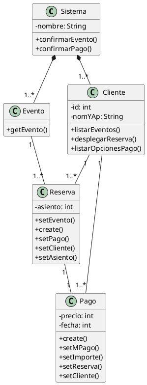

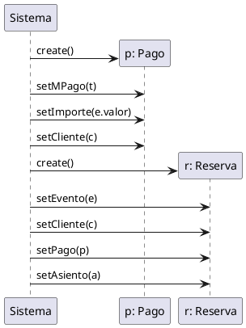

   O si ya son muchos datos se puede hacer de la siguiente forma (según la profe): un único `set` con todos los datos.

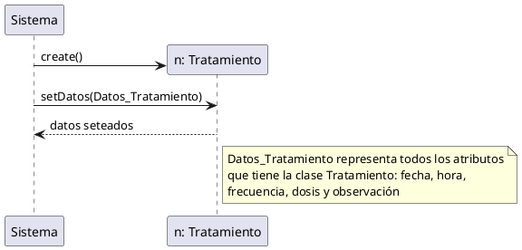

##### 3. Tipos de mensajes y sincronía

1. **Mensajes Síncronos (punta rellena y línea continua):** El emisor bloquea y espera respuesta. Es el estándar para llamadas internas del sistema.
2. **Mensajes Asíncronos (punta abierta y línea continua; la línea discontinua queda solo para los retornos):** El emisor no espera respuesta inmediata. Uso obligatorio para comunicación con Actores Externos debido a latencias de red.

```plantuml
Sistema -> Eventos: getEvento()
Eventos --> Sistema: Evento
```

##### 4. Mensajes a través de otra clase

*(Sección sin desarrollar en el apunte original.)*

##### 5. Paso de parámetros y retornos

1. **Ida:** Incluir explícitamente los parámetros necesarios en las firmas (ej: `procesarPago(idMedioPago, datosPago)`).
2. **Vuelta:** Utilizar línea punteada (`-->`) indicando únicamente el nombre del dato retornado. **Prohibido incluir la palabra reservada `return:` o `retornar`.**

```plantuml
Sistema ->> "Entidad Bancaria": getValidacion(id_usuario, cuenta)
"Entidad Bancaria" --> Sistema: PagoValidado
```

##### 6. Mensajes reflexivos (Self-Message)

1. Graficar explícitamente cuando una instancia invoca un método de su propia clase para delegar cálculos internos (ej: una flecha que sale y entra de `Sistema -> Sistema: calcularTotal()`).

```plantuml
Ventas -> Ventas: calcularTotal()
```

##### 7. Recorridos de clases entidades (búsqueda filtrada)

1. Para recorrer una clase, por ejemplo *Clientes*, ya sea con un filtro o no, se la nombra con el formato **`LT` + una letra que indica a qué clase corresponde**. Por ejemplo, para la clase *Clientes* queda **`LTC: Clientes`**.
2. Esto está diciendo que es una lista de clientes (`c`) sobre la clase `Clientes`.
3. No se puede recorrer una clase `Clientes` sin esto que se explica.
4. De no necesitar recorrer, ahí sí se pone solamente `Clientes`.

> **Nota:** el PDF original escribe esta notación como `LL[c]: Clientes` y `LLT[filtrados]: Clientes`. En este repositorio se usa la notación `LTC` / `LTTC` indicada en clase.

```plantuml
participant "Sistema" as Sistema
participant "LTC: Clientes" as LTC

loop for each c in LTC
    Sistema -> LTC: getCliente()
    LTC --> Sistema: c
end
```

##### 8. Manejo de listas temporales

1. La clase **Sistema es la única responsable** de instanciar (`create`) y agregar datos (`add()`) a listas temporales, generalmente dentro de un `loop`.
2. **Regla visual:** No graficar una flecha de retorno desde la lista temporal hacia el Sistema tras agregar elementos. O sea, no poner un `return()` al Sistema, ya que una vez creada la misma, el sistema la conoce de por sí.
3. Al final del uso de esa lista temporal, se hace un `destroy()`, que es un mensaje que le envía el Sistema. *(La profe dijo que no hace falta hacer esto en el parcial, pero es lo correcto, y se deja por si en otro año le pinta pedir.)*
4. **Nomenclatura:** a la notación de lista solo se le agrega una **T**. La lista temporal de *Clientes* queda **`LTTC: Clientes`** (y, en general, `LTT` + la letra de la clase).

Acá lo que pasa de forma coloquial es esto (es una receta que casi siempre se repite):

1. El Sistema crea la `ListaTemporal`; la lista tiene el mismo tipo que el objeto que almacena, o sea `:Clientes`.
2. Ahora viene el `loop`: por cada `c` en `Clientes` va a hacer el mismo loop. Es como un `for` de Python; `c` viene a ser el elemento unitario de `Clientes`.
3. Entonces lo que pasa sí o sí en el loop es que se busca un cliente y se retorna un cliente de la lista de todos los clientes al Sistema.
4. En el `opt` ponemos nuestra condición para almacenarlo en nuestra `ListaTemporal`. Si se cumple la condición va a la lista temporal; esa lista temporal es la que vamos a tener para devolverle al usuario o usarla para otro paso del CU que requiera dicha lista.

```plantuml
participant "Sistema" as Sistema
participant "LTC: Clientes" as LTC

create "LTTC: Clientes" as LTTC
Sistema -> LTTC: create()

loop for each c in LTC
    Sistema -> LTC: getCliente()
    LTC --> Sistema: c
    opt c.atributo = condicion de filtrado
        Sistema -> LTTC: add(c)
    end
end
```

##### 9. Búsqueda indexada

Si se tiene algo por lo cual indexar, como puede ser un `id`, directamente puede buscarse de esta manera, ahorrando así la idea de hacer un `loop` para buscar solamente un elemento.

```plantuml
Sistema -> Cliente: getCliente(id)
Cliente --> Sistema: c
```

##### 10. Creación de objetos de entidades de negocio

1. **Entidades simples:** El Sistema instancia nuevas entidades al finalizar procesos exitosos. La flecha con el mensaje `create(...)` debe apuntar directamente a la cabecera (caja superior) de la nueva entidad.
2. **Estructuras Todo-Parte (Composición):** El Sistema **NO** instancia los detalles directamente. Primero hace el `create` de la cabecera (ej: *Reserva*). Luego, dentro de un `loop`, la cabecera recibe el mensaje para agregar detalles y es **ELLA** quien ejecuta el `create` hacia sus objetos hijos (ej: *Entradas*).

```plantuml
create "r: Reserva" as r
Sistema -> r: create()
```

##### 11. Fragmentos de interacción o control (marcos lógicos)

1. **`alt` (Alternativa):** Modela flujos mutuamente excluyentes (if/else). Esencial para caminos alternativos.
2. **`opt` (Opcional):** Modela comportamiento condicional simple (if).
3. **`loop` (Bucle):** Iteración obligatoria al recorrer colecciones desde el Sistema.
4. **`ref` (Referencia):** Actúa como un "include" visual. Encapsula y reutiliza flujos complejos ya documentados en otro diagrama (ej: `ref: Validar Pago Externo`), evitando saturar el diagrama principal.

##### 12. Actores externos

1. El envío de información a pasarelas de pago o servicios (ej: AFIP) lo ejecuta el **Sistema directamente hacia el Actor Externo**. No se modelan como clases del sistema.

```plantuml
actor "Entidad Bancaria" as Banco
Sistema ->> Banco: validarPago()
Banco --> Sistema: pagoValidado
```

##### 13. Coherencia absoluta

1. Todo mensaje enviado (el que recibe la punta de la flecha) debe existir obligatoriamente como un método en la tarjeta CRC y en el diagrama de clases de esa entidad receptora.

---

### 3 - Tarjeta CRC

Las tarjetas CRC (Clase-Responsabilidad-Colaboración) son esenciales para definir el comportamiento y las interacciones de cada clase en el sistema. Deben organizarse de la siguiente manera.

**Qué tienen:**

* **Nombre de la clase:** Identificador único de la clase.
* **Propósito:** Descripción breve y clara del rol que cumple la clase dentro del dominio del problema.
* **Responsabilidades:** Qué tareas sabe realizar y qué información conoce (métodos principales y datos clave).
  * Acá, para hacerlo corto y al pie, tenés que mirar **los métodos de la clase**.
* **Colaboradores:** Otras clases con las que interactúa para cumplir sus tareas (quién le pide servicios o a quién ella debe pedirle servicios).
  * Mirá **las asociaciones de tu diagrama de clases** y escribí sus nombres.

**Ejemplo** (clase `Reserva` del diagrama de clases de arriba):

```text
+-----------------------------------------------------------------+
| RESERVA                                                         |
| PROPÓSITO: Clase encargada de representar la reserva hecha por  |
| un cliente en cierta ubicación de un evento                     |
+--------------------------------------+--------------------------+
| Responsabilidad                      | Colaboración             |
+--------------------------------------+--------------------------+
| - Conocer el evento correspondiente  | - Evento                 |
|   a la reserva                       | - Cliente                |
| - Crear una reserva                  | - Pago                   |
| - Conocer el pago correspondiente    |                          |
|   a la reserva                       |                          |
| - Conocer al cliente asociado a la   |                          |
|   reserva                            |                          |
| - Conocer el asiento correspondiente |                          |
|   a la reserva                       |                          |
+--------------------------------------+--------------------------+
```

* **Responsabilidades:**
  * `setEvento()` = *"Conocer el evento correspondiente a la reserva"*.
  * `create()` = *"Crear una reserva"*.
  * Así con todos los métodos de la clase. Es más "chamullo" que otra cosa; por eso es más fácil hacer esto una vez que ya tengas el diagrama de clases post diagrama de secuencia.
* **Colaboración:**
  * Acá no hay mucha historia: *Reserva* tiene asociación en el diagrama de clases con *Evento*, *Cliente* y *Pago*; esas son entonces sus colaboraciones.

**Consejos:**

* **Coherencia:** Cada clase del diagrama de clases del caso de uso debe tener su tarjeta CRC correspondiente. *(En el parcial, por lo visto, piden 3 nomás.)*
* **Simplicidad:** Si el reverso de la tarjeta acumula demasiadas responsabilidades, evaluar si la clase está sobrecargada (posible violación del principio de responsabilidad única) y se debería dividir.
* **Foco en el CU:** Las responsabilidades listadas deben ser aquellas que la clase realmente ejecuta durante el flujo del caso de uso analizado.

```text
CRC: Clase

+-----------------------------------------------+
|  Clase: Clase                                 |
|  Propósito: ----                              |
+-----------------------------------------------+

+-----------------------+-----------------------+
|  Responsabilidades:   |  Colaboración:        |
+-----------------------+-----------------------+
|                       |                       |
+-----------------------+-----------------------+
```

---

## Máquina de estados

**Objetivo:** Una máquina de estados modela el **ciclo de vida de un único objeto de una clase**: en qué situaciones puede estar, qué eventos lo hacen cambiar y qué hace al cambiar.

| Elemento | Definición | Notación | Ejemplo |
| :--- | :--- | :--- | :--- |
| **Estado** | Condición o situación que dura en el tiempo y determina el comportamiento del objeto | Rectángulo de esquinas redondeadas | `Confirmado`, `Verificando datos` |
| **Evento** | Acontecimiento significativo, sin duración, localizado en tiempo y espacio; se modela cuando tiene consecuencias | Primer término sobre la flecha | `confirmar()`, `after(48 h)` |
| **Transición** | Pasaje de un estado origen a un estado destino | Flecha continua | `Reservado → Confirmado` |
| **Guarda** | Condición booleana que habilita la transición | `[ ... ]` | `[cupo > 0]` |
| **Acción** | Operación instantánea que se ejecuta al transitar | `/ acción` | `/ liberarHorario()` |
| **Estado inicial** | Pseudoestado de arranque: uno solo por diagrama (y uno propio dentro de cada estado compuesto) | Círculo relleno ● | — |
| **Estado final** | Fin del ciclo de vida: puede haber varios, lo recomendable es uno solo | Círculo con borde ◉ | — |

**Estado inicial ● y final ◉:** debe haber un solo estado inicial; puede haber más de un estado final, pero lo recomendable es uno solo. Los estados significativos se nombran con claridad (ej: *EsperandoTarjeta*, *ValidandoTarjeta*, *En Carrito*, *ProcesandoPago*).

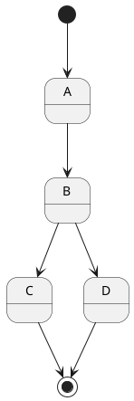

### Procedimiento de resolución

1. **Objeto y tipo de ciclo:** Subrayar en el enunciado el sustantivo cuyo estado cambia (*Turno*, *Pedido*, *Trámite*) y los verbos que le ocurren.
   * **Finito** (*Pedido*, *Turno*, *Inscripción*): va de ● a ◉ cuando el ciclo concluye (*Cancelado*, *Entregado*).
   * **Continuo o reactivo** (*Teléfono*, *Ascensor*, *Cajero*): vuelve a un estado de reposo (*Inactivo*, *Detenido*) sin ◉, salvo una destrucción.
2. **Estados:** Salen de los **adjetivos y participios** del enunciado ("pendiente", "confirmado", "cancelado").
   * **Verificar:** Si el objeto puede quedarse ahí esperando algo, entonces es un estado. Si no, va a ser un evento o acción.
   * **Nombres:** adjetivo o participio (*Confirmado*, *Pendiente*) o, si el objeto está haciendo algo, *Verificando datos*. **Nunca infinitivo** como *Confirmar*.
3. **Transiciones:** Por cada estado, preguntarse qué puede ocurrirle y adónde va.
4. **Estados compuestos:** Si dos o más estados comparten la **misma transición de salida** (mismo evento, mismo destino), agruparlos en un estado compuesto y sacar una sola flecha desde su borde.

**Ejemplo sin compuesto** (teléfono):

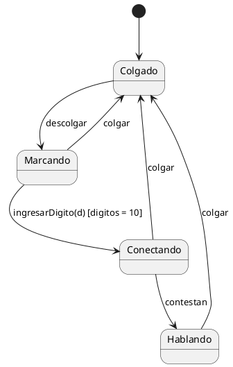

**Con estado compuesto:**

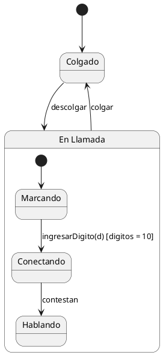

### Coherencia con el resto del parcial

* Cada **evento de llamada** es una operación de la clase: tiene que figurar en su diagrama de clases y su tarjeta CRC.
* Cada **acción** es un método propio o un mensaje a otro objeto.
* La clase necesita un **atributo `estado`** (o, si piden el patrón State, cada estado del diagrama pasa a ser una clase `EstadoConcreto`).
* **Precondición/postcondición del CU = estado del objeto antes y después:** si el CU "Confirmar Turno" deja el turno confirmado, en la máquina tiene que existir `Reservado → Confirmado` con `confirmar()`.

### Ejemplo resuelto: licencia de conducir

**Enunciado:** la Municipalidad de Ciudad Verde gestiona el trámite de licencia. El ciudadano presenta la solicitud con su documentación; luego la municipalidad evalúa el trámite (verificación de datos, examen teórico, examen práctico, evaluación médica). Si todos los pasos son correctos se aprueba y se emite la licencia; si cualquiera no se cumple, se rechaza.

**Paso 1:** Objeto: *Trámite de licencia*. Ciclo finito: empieza al presentar la solicitud y termina aprobado o rechazado → lleva ● y ◉.

**Paso 2:** *Presentada*, *En Evaluación*, *Aprobada*, *Rechazada*. Los cuatro pasos internos de la evaluación quedan para el paso 4.

**Paso 3:** Transiciones.

| Origen | Evento [guarda] / acción | Destino |
| :--- | :--- | :--- |
| ● | — | Presentada |
| Presentada | — (automática) | En Evaluación |
| En Evaluación | [trámite = ok] / generarLicencia() | Aprobada |
| En Evaluación | [trámite = conProblemas] / enviarNotificación() | Rechazada |
| Aprobada, Rechazada | — | ◉ |

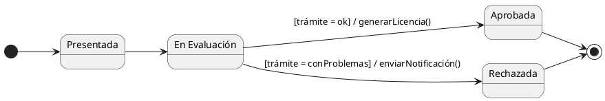

**Paso 4:** *En Evaluación* esconde cuatro pasos secuenciales: *Verificando datos → Evaluando Teoría → Evaluando Práctica → Evaluando parte médica*.

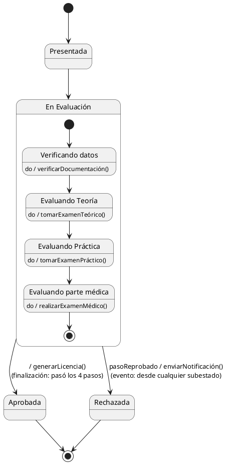

---

## Patrones de Diseño

Descripción de un problema y la esencia de su solución reutilizable en distintos casos.

**Cómo usar los diagramas:** los nombres (*Creador*, *Sujeto*, *Contexto*, etc.) son **roles genéricos** del patrón. En el parcial se reemplazan por las clases del escenario. Para cada patrón se indica qué rol cumple cada clase y un ejemplo concreto.

### Patrones de Creación

**Propósito:** Proceso de instanciar objetos.

#### Singleton

Asegura una única instancia de clase y proporciona un punto de acceso global a dicha instancia.

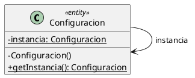

**Cómo leerlo:** el constructor es privado (`-`), así que nadie puede hacer `new` desde afuera. La clase guarda su única instancia en un atributo estático (subrayado) y la entrega con `getInstancia()`.
**Ejemplo:** *Configuracion* del sistema, que debe ser la misma para todos los que la consulten.

#### Factory Method

Define una interfaz de creación delegando en las subclases la decisión de qué clase concreta instanciar.

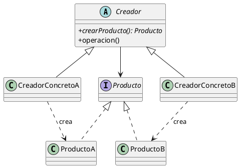

**Cómo leerlo:** *Creador* declara `crearProducto()` como abstracto (en cursiva) y cada creador concreto decide qué producto crea (flecha punteada «crea»). Quien usa *Creador* no sabe qué clase concreta se instancia.
**Ejemplo:** *Notificador* (Creador) con *NotificadorEmail*, que crea un *Email*, y *NotificadorSMS*, que crea un *SMS*.

#### Abstract Factory

Proporciona una interfaz para crear familias de objetos relacionados o dependientes sin especificar sus clases concretas.

```plantuml
@startuml
skinparam classAttributeIconSize 0
interface FabricaGUI {
    + crearBoton(): Boton
    + crearVentana(): Ventana
}
interface Boton
interface Ventana
class FabricaWindows
class FabricaMac
class BotonWindows
class BotonMac
class VentanaWindows
class VentanaMac
FabricaGUI <|.. FabricaWindows
FabricaGUI <|.. FabricaMac
Boton <|.. BotonWindows
Boton <|.. BotonMac
Ventana <|.. VentanaWindows
Ventana <|.. VentanaMac
FabricaWindows ..> BotonWindows
FabricaWindows ..> VentanaWindows
FabricaMac ..> BotonMac
FabricaMac ..> VentanaMac
@enduml
```

**Cómo leerlo:** cada fábrica concreta crea una **familia completa** de productos que van juntos (todos Windows o todos Mac). El cliente solo conoce las interfaces (*FabricaGUI*, *Boton*, *Ventana*), nunca las clases concretas.
**Diferencia con Factory Method:** acá se crean varios productos relacionados, no uno solo.
**Ejemplo:** *FabricaWindows* produce *BotonWindows* y *VentanaWindows*.

### Patrones Estructurales

**Propósito:** Composición de objetos.

#### Composite

Compone objetos en estructuras arborescentes para representar jerarquías parte-conjunto. Permite tratar objetos individuales y composiciones de manera uniforme.

```plantuml
@startuml
skinparam classAttributeIconSize 0
interface Componente {
    + operacion()
}
class Hoja {
    + operacion()
}
class Compuesto {
    + operacion()
    + agregar(c: Componente)
    + quitar(c: Componente)
}
Componente <|.. Hoja
Componente <|.. Compuesto
Compuesto o-- "0..*" Componente : hijos
@enduml
```

**Cómo leerlo:** *Hoja* y *Compuesto* implementan la misma interfaz *Componente*, por eso se usan igual. El *Compuesto* contiene 0..* *Componentes* (hijos), que pueden ser hojas u otros compuestos.
**Ejemplo:** *Carpeta* (Compuesto) con *Archivos* (Hoja) y otras carpetas; `calcularTamaño()` se pide igual a un archivo o a una carpeta.

#### Facade

Proporciona una interfaz unificada de alto nivel que simplifica el uso de las interfaces de un subsistema complejo.

```plantuml
@startuml
skinparam classAttributeIconSize 0
class Cliente
class Fachada {
    + operacionSimple()
}
class SubsistemaA
class SubsistemaB
class SubsistemaC
Cliente --> Fachada
Fachada --> SubsistemaA
Fachada --> SubsistemaB
Fachada --> SubsistemaC
@enduml
```

**Cómo leerlo:** el *Cliente* habla solo con la *Fachada* (una flecha), y es ella la que coordina los subsistemas. El cliente no conoce las clases de adentro.
**Ejemplo:** `confirmarCompra()` en la fachada llama internamente a *Stock*, *Pago* y *Envío*.

#### Proxy

Proporciona un representante o sustituto para controlar el acceso a otro objeto. Se aplica en proxies remotos, virtuales o de protección.

```plantuml
@startuml
skinparam classAttributeIconSize 0
class Cliente
interface Sujeto {
    + solicitar()
}
class Proxy {
    - sujetoReal: SujetoReal
    + solicitar()
}
class SujetoReal {
    + solicitar()
}
Cliente --> Sujeto
Sujeto <|.. Proxy
Sujeto <|.. SujetoReal
Proxy --> SujetoReal
@enduml
```

**Cómo leerlo:** *Proxy* y *SujetoReal* implementan la misma interfaz *Sujeto*, así el *Cliente* no nota la diferencia. El *Proxy* guarda una referencia al *SujetoReal* y decide si y cuándo delegarle la llamada.
**Ejemplo (proxy de protección):** *ProxyDocumento* verifica los permisos antes de dejar acceder al *Documento* real.

### Patrones de Comportamiento

**Propósito:** Comunicación, cooperación y distribución de responsabilidades entre objetos.

#### State

Permite que un objeto modifique su comportamiento cada vez que cambia su estado interno.

```plantuml
@startuml
skinparam classAttributeIconSize 0
class Contexto {
    - estado: Estado
    + solicitar()
    + cambiarEstado(e: Estado)
}
interface Estado {
    + manejar(c: Contexto)
}
class EstadoConcretoA
class EstadoConcretoB
Contexto --> Estado
Estado <|.. EstadoConcretoA
Estado <|.. EstadoConcretoB
@enduml
```

**Cómo leerlo:** *Contexto* tiene un atributo `estado` de tipo *Estado* y le delega el trabajo. Cada *EstadoConcreto* implementa `manejar()` a su manera, y al ejecutar `cambiarEstado()` cambia el comportamiento **sin usar if/else**.
**Relación con la máquina de estados:** cada estado del diagrama pasa a ser una clase.
**Ejemplo:** *Pedido* (Contexto) con *EstadoPendiente* y *EstadoPagado*; `cancelar()` hace cosas distintas en cada uno.

#### Observer

Define una dependencia de uno-a-muchos para notificar y actualizar automáticamente a los objetos dependientes ante cambios de estado.

```plantuml
@startuml
skinparam classAttributeIconSize 0
class Sujeto {
    - estado
    + agregar(o: Observador)
    + quitar(o: Observador)
    + notificar()
}
interface Observador {
    + actualizar()
}
class ObservadorConcreto {
    + actualizar()
}
Sujeto o-- "0..*" Observador
Observador <|.. ObservadorConcreto
ObservadorConcreto --> Sujeto
@enduml
```

**Cómo leerlo:** *Sujeto* guarda una lista de 0..* *Observadores*. Cuando cambia su estado ejecuta `notificar()`, que llama a `actualizar()` de cada observador suscripto. *Sujeto* solo conoce la interfaz *Observador*, no las clases concretas.
**Ejemplo:** *Producto* (Sujeto) avisa a los *Clientes* suscriptos cuando vuelve a haber stock.

#### Iterator

Proporciona acceso secuencial a los elementos de un contenedor sin exponer su representación interna. Permite iteración polimórfica.

```plantuml
@startuml
skinparam classAttributeIconSize 0
interface Agregado {
    + crearIterador(): Iterador
}
class AgregadoConcreto {
    + crearIterador(): Iterador
}
interface Iterador {
    + primero()
    + siguiente()
    + hayMas(): boolean
    + actual(): Elemento
}
class IteradorConcreto
Agregado <|.. AgregadoConcreto
Iterador <|.. IteradorConcreto
AgregadoConcreto ..> IteradorConcreto : crea
IteradorConcreto --> AgregadoConcreto
@enduml
```

**Cómo leerlo:** el *Agregado* crea un *Iterador* con `crearIterador()`, y el cliente recorre con `primero()`, `siguiente()` y `hayMas()` sin saber si por dentro hay una lista, un árbol u otra estructura.
**Ejemplo:** recorrer los *Clientes* sin exponer cómo se almacenan.

---

## Diagrama de clases en Java

*(Extra.)*

### Estructura general

```java
public class NombreClase {
    // <<estereotipo>>: entity, control o boundary

    // Atributos: siempre privados
    private Tipo atributo;
    private Tipo atributoDerivado;

    // Constructor
    public NombreClase(Tipo atributo) {
        this.atributo = atributo;
    }

    // Operaciones
    public Retorno operacionDominio(Tipo p) { ... }
    protected void operacionProtegida() { ... }
    private void operacionPrivada() { ... }
}
```

Los estereotipos (`control`, `boundary`, `entity`) no existen en Java: se escriben como comentario sobre la clase.

### Paso a paso para pasar la clase del diagrama a Java

1. **Paso 1:** Declarar la clase con el nombre del diagrama (`public class`). Si en el diagrama es abstracta, usar `abstract class`; si es una interfaz, `interface`.
2. **Paso 2:** Declarar los atributos del compartimento del medio, siempre privados (`-`): `private Tipo nombre;`.
3. **Paso 3:** Escribir el constructor, que recibe los valores iniciales y los asigna con `this`.
4. **Paso 4:** Declarar cada operación del compartimento inferior con su visibilidad: `+` es `public`, `-` es `private` y `#` es `protected`. La firma es: `visibilidad Retorno nombre(Tipo parametro)`.
5. **Paso 5:** Por cada flecha del diagrama, agregar la relación en el código (ver tabla de abajo).
6. **Paso 6:** Por cada multiplicidad, elegir cómo se guarda: un solo objeto o una colección (`List`).
7. **Paso 7:** Revisar que cada mensaje del diagrama de secuencia exista como método en la clase que lo recibe.

### Relaciones

| Tipo | Java | Criterio |
| :--- | :--- | :--- |
| **Dependencia** | `void metodo(B b) { ... }` o variable local `B b` dentro de un método de `A` | Usa `B` como parámetro o variable local |
| **Asociación** | En `A`: `private B b;` | `A` conoce a `B`; la flecha indica navegabilidad |
| **Agregación** | En `A`: `private B b;` y `B` llega de afuera (por constructor o setter: `this.b = b;`) | "Tiene un"; `B` existe sin `A` |
| **Composición** | En `A`: `private B b = new B();` (`A` crea a `B` y nadie más lo referencia) | "Es parte de"; `B` muere con `A` |
| **Generalización** | `class B extends A` | `B` hereda de `A` (relación "es un") |
| **Realización** | `class B implements A` | `B` implementa la interfaz `A` |

### Multiplicidades

| Notación | Significado | Ejemplo |
| :--- | :--- | :--- |
| `1` | Exactamente uno | *Prestamo* tiene un *Alumno*: `private Alumno alumno;` (siempre asignado en el constructor) |
| `0..1` | Opcional | *Ejemplar* con préstamo activo: `private Prestamo prestamo;` (puede ser `null`) |
| `*` o `0..*` | Cero o más | *Alumno* con muchos *Prestamo*: `private List<Prestamo> prestamos = new ArrayList<>();` |
| `1..*` | Al menos uno | *Libro* con ≥ 1 *Ejemplar*: `List<Ejemplar>` que se inicializa con al menos un elemento en el constructor |
| `n..m` | Rango | 0..3 préstamos simultáneos: `List<Prestamo>` y el límite se valida en el método que agrega |

### Sintaxis en Java: relaciones con multiplicidad

```java
// Libro "1" *-- "1..*" Ejemplar (composición: el Libro crea sus Ejemplares y nace con al menos uno)
public class Libro {
    private List<Ejemplar> ejemplares = new ArrayList<>();

    public Libro(String codigoPrimerEjemplar) {
        ejemplares.add(new Ejemplar(codigoPrimerEjemplar));
    }

    public void agregarEjemplar(String codigo) {
        ejemplares.add(new Ejemplar(codigo));
    }
}

// Alumno "1" --> "0..3" Prestamo (asociación con máximo 3)
public class Alumno {
    private List<Prestamo> prestamos = new ArrayList<>();

    public void agregarPrestamo(Prestamo p) {
        if (prestamos.size() >= 3) {
            throw new IllegalStateException("Máximo 3 préstamos");
        }
        prestamos.add(p);
    }
}

// Herencia e interfaz: B extends A / B implements A
public abstract class Persona { ... }
public class Alumno extends Persona implements Prestable { ... }
```
